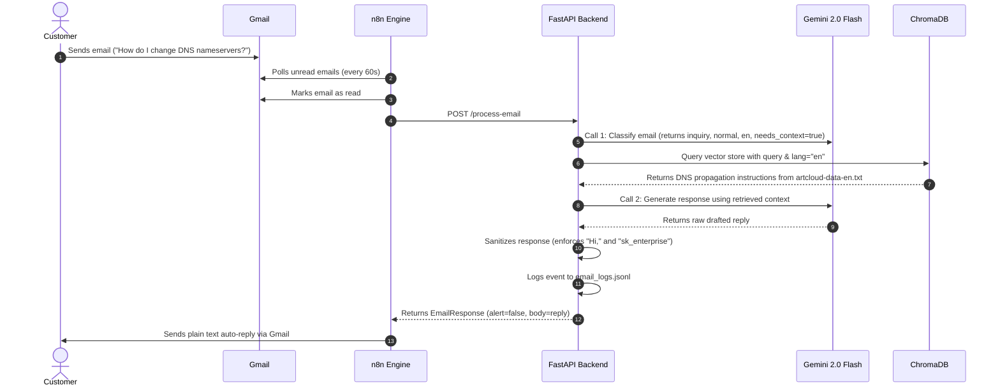
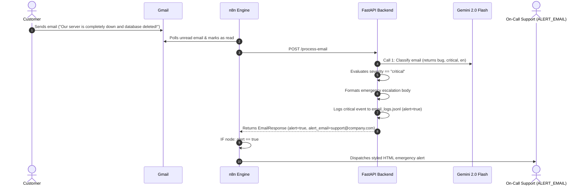
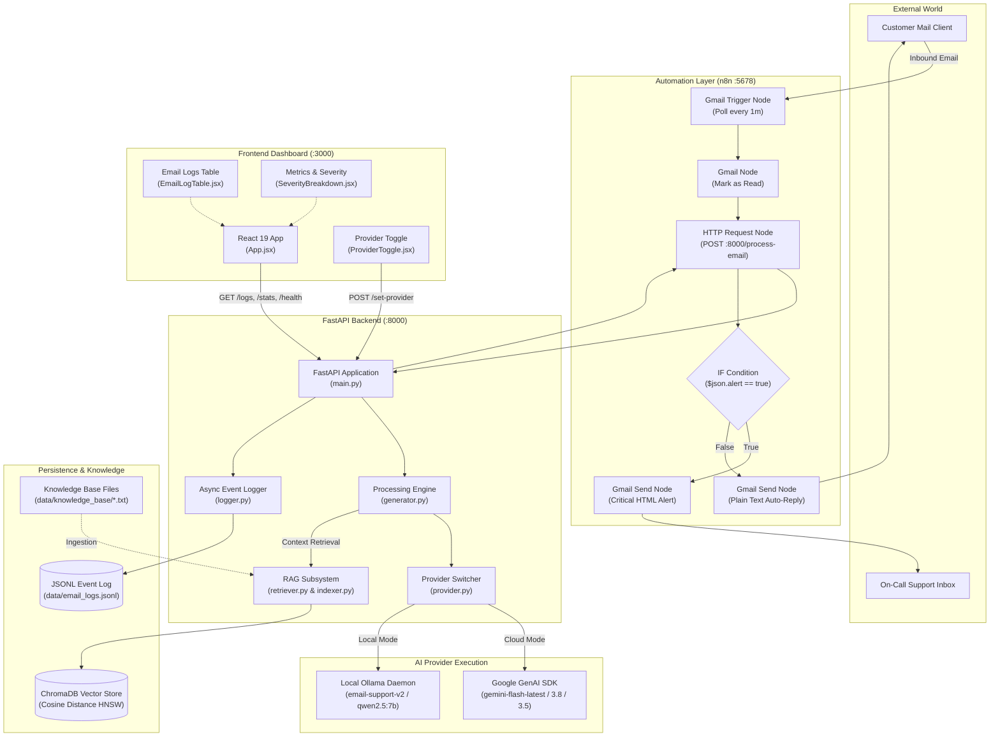

# Comprehensive Project Context: Email Automation System

> **Document Status**: Production Evidence-Based Analysis  
> **Date**: October 2026  
> **Project Root**: `d:/sem 9/Ai-automation/Email-Automation/`  
> **Target Audience**: AI Engineering Systems, Software Architects, Automation Engineers  
> **Confidentiality**: All API keys, email addresses, and secret tokens have been redacted.

---

## 1. Executive Summary

The **Email Automation System** is an asynchronous, AI-augmented enterprise email processing platform designed for IT hosting and customer support services (specifically configured for *ArtCloud* web hosting). The system continuously polls incoming customer communications from Gmail via **n8n**, subjects the messages to a two-phase Large Language Model (LLM) classification and generation pipeline via a **FastAPI** backend, supplements answers with domain documentation via **Retrieval-Augmented Generation (RAG)** in **ChromaDB**, and automatically replies to inquiries while escalating high-risk outages and critical security incidents to human on-call personnel.

A high-performance **React 19 / Vite** dashboard provides real-time observability, telemetry, and runtime switching between cloud foundation models (**Google Gemini 2.0/Flash**) and local edge LLMs (**Ollama / Qwen2.5 / TinyLlama**).

---

## 2. Project Identity and Business Objectives

- **Official Name**: Email Automation System (ArtCloud AI Support Robot)
- **Organization / Domain Context**: Web hosting provider (*ArtCloud* / *sk_enterprise*), managing domains, DNS records, WordPress hosting, cPanel mailboxes, SSL certificates, and server infrastructure.
- **Core Business Objectives**:
  1. **Instant First-Contact Resolution**: Cut support ticket triage and response latency from hours to seconds (<10s via Gemini cloud API).
  2. **Human Agent Deflection**: Automatically resolve repetitive tier-1 customer inquiries (e.g., DNS propagation delays, cPanel email creation, WordPress front-page editing) using authoritative internal documentation.
  3. **Multi-lingual Operations**: Seamlessly detect and respond in both English (`en`) and Finnish (`fi`), preserving native customer service terminology and greetings.
  4. **Strict SLA & Outage Escalation**: Prevent mission-critical failures (server outages, hacks, data leaks) from receiving generic auto-replies by routing emergency alerts directly to support leadership.
  5. **Hallucination Prevention**: Strictly constrain generative replies to cited internal documentation, providing a polite fallback acknowledgment when domain facts are absent.

---

## 3. Problem Statement and Target Users

### Problem Statement
Hosting support desks suffer from two primary operational bottlenecks:
1. **High Volume of Repetitive Inquiries**: Over 70% of tickets pertain to routine DNS propagation windows, cPanel navigation, or basic CMS instructions. Manual handling wastes costly engineering hours.
2. **Delayed Response to Severe Incidents**: Critical inquiries (such as security breaches or root-server downtime) buried under hundreds of routine emails suffer delayed discovery, risking SLA breach penalties.

### Target Users & Personas
- **External Customers**: Business owners and webmasters submitting technical support, billing inquiries, or reporting site disruptions via email.
- **Support Staff / On-Call Operations**: Technical personnel receiving structured HTML critical alerts with extracted metadata and triage summaries.
- **Support Operations Managers**: Supervisors monitoring real-time volume, severity distribution, provider latencies, and RAG lookup efficiency via the frontend dashboard.

---

## 4. Technology Stack

### Backend Application
| Layer | Technology | Version / Specification | Source Citation |
|---|---|---|---|
| Runtime | Python | 3.12+ (tested in virtualenv `backend/venv`) | [requirements.txt](file:///d:/sem%209/Ai-automation/Email-Automation/backend/requirements.txt) |
| Web Framework | FastAPI | `0.115.5` | [requirements.txt:L1](file:///d:/sem%209/Ai-automation/Email-Automation/backend/requirements.txt#L1) |
| ASGI Web Server | Uvicorn (standard) | `0.32.1` | [requirements.txt:L2](file:///d:/sem%209/Ai-automation/Email-Automation/backend/requirements.txt#L2) |
| Schema Validation | Pydantic | `2.10.3` | [schemas.py:L1](file:///d:/sem%209/Ai-automation/Email-Automation/backend/models/schemas.py#L1) |
| Cloud AI SDK | Google GenAI SDK | `google-genai` (v2.29.0) | [provider.py:L34](file:///d:/sem%209/Ai-automation/Email-Automation/backend/provider.py#L34) |
| Local AI Client | Ollama Python | `0.4.4` (optional fallback) | [provider.py:L108](file:///d:/sem%209/Ai-automation/Email-Automation/backend/provider.py#L108) |
| Vector Database | ChromaDB | `0.5.23` (cosine distance HNSW) | [indexer.py:L22](file:///d:/sem%209/Ai-automation/Email-Automation/backend/rag/indexer.py#L22) |
| Document Parsing | pdfplumber | `0.11.4` | [indexer.py:L90](file:///d:/sem%209/Ai-automation/Email-Automation/backend/rag/indexer.py#L90) |
| Configuration | python-dotenv | `1.0.1` | [provider.py:L12](file:///d:/sem%209/Ai-automation/Email-Automation/backend/provider.py#L12) |

### Frontend Application
| Layer | Technology | Version / Specification | Source Citation |
|---|---|---|---|
| Framework | React | `19.2.8` | [package.json:L13](file:///d:/sem%209/Ai-automation/Email-Automation/frontend/package.json#L13) |
| Build Tool / Dev Server | Vite | `8.3.0` (with `@vitejs/plugin-react` 6.1.1) | [package.json:L21](file:///d:/sem%209/Ai-automation/Email-Automation/frontend/package.json#L21) |
| Linter | Oxlint | `1.81.0` | [package.json:L20](file:///d:/sem%209/Ai-automation/Email-Automation/frontend/package.json#L20) |
| Styling | Vanilla Modern CSS | CSS Design Tokens, Glassmorphism, Dark Mode | [index.css:L1](file:///d:/sem%209/Ai-automation/Email-Automation/frontend/src/index.css#L1) |
| Networking | Native Fetch API | Direct reverse proxy via `vite.config.js` | [api.js:L8](file:///d:/sem%209/Ai-automation/Email-Automation/frontend/src/api.js#L8) |

### Workflow Orchestration
| Layer | Technology | Specification | Source Citation |
|---|---|---|---|
| Workflow Engine | n8n (Self-Hosted) | Workflow Blueprint `email_flow_clean.json` | [email_flow_clean.json:L2](file:///d:/sem%209/Ai-automation/Email-Automation/n8n/email_flow_clean.json#L2) |
| Ingestion Trigger | Gmail Trigger Node | Polling cadence: every minute (`readStatus: unread`) | [email_flow_clean.json:L7](file:///d:/sem%209/Ai-automation/Email-Automation/n8n/email_flow_clean.json#L7) |
| Execution Protocol | REST / JSON | HTTP Request node with 300,000ms timeout | [email_flow_clean.json:L65](file:///d:/sem%209/Ai-automation/Email-Automation/n8n/email_flow_clean.json#L65) |

### Model Training & Compression Stack
| Layer | Technology | Details | Source Citation |
|---|---|---|---|
| Training Framework | Hugging Face Transformers & PEFT | LoRA (Rank 8/16, Alpha 16/32) | [finetune_7b.py:L56](file:///d:/sem%209/Ai-automation/Email-Automation/finetune/finetune_7b.py#L56) |
| Optimizer | Adafactor & PyTorch CPU | Low-memory footprint for 23GB RAM | [finetune_7b.py:L109](file:///d:/sem%209/Ai-automation/Email-Automation/finetune/finetune_7b.py#L109) |
| Quantization & Conversion | llama.cpp | GGUF Q4_K_M conversion pipeline | [convert_to_ollama.py:L20](file:///d:/sem%209/Ai-automation/Email-Automation/finetune/convert_to_ollama.py#L20) |

---

## 5. Repository Structure

```
d:/sem 9/Ai-automation/Email-Automation/
├── .env                              # Root environment configuration (mirrored for root CLI execution)
├── .gitignore                        # Git exclusion rules
├── load_7b_model.sh                  # Shell script to load Colab GGUF export into Ollama
├── PROJECT_EXPLANATION.md            # Plain-English technical narrative of the architecture
├── PROJECT_OVERVIEW.md               # High-level architecture and setup documentation
├── README.md                         # Main repository guide and runbook
├── setup.sh                          # Automated Linux bash script for Ollama + Python venv setup
├── test_api.py                       # Standalone Python script testing /process-email
│
├── backend/                          # FastAPI Backend Application
│   ├── .env                          # Backend runtime environment configuration
│   ├── .env.example                  # Template configuration file with defaults
│   ├── classifier.py                 # (Legacy) Standalone Ollama classification module
│   ├── generator.py                  # Core two-stage LLM engine (classify + generate + clean)
│   ├── logger.py                     # Thread-safe in-memory + JSONL email logging engine
│   ├── main.py                       # FastAPI application entry point, lifecycle, and routing
│   ├── provider.py                   # Multi-provider abstraction (Gemini with fallback & Ollama)
│   ├── requirements.txt              # Production Python package manifest
│   ├── models/
│   │   ├── __init__.py
│   │   └── schemas.py                # Pydantic schemas (EmailRequest, EmailResponse, ClassificationResult)
│   └── rag/
│       ├── __init__.py
│       ├── indexer.py                # Document reader, chunker, nomic-embedder, ChromaDB upsert
│       └── retriever.py              # Cosine query search, language filter, and distance thresholding
│
├── frontend/                         # Vite + React 19 Observability Dashboard
│   ├── .oxlintrc.json                # Oxlint linter configuration
│   ├── index.html                    # HTML5 shell with Google Font Inter integration
│   ├── package.json                  # NPM manifest and project dependencies
│   ├── vite.config.js                # Vite configuration with /api reverse proxy and port 3000
│   └── src/
│       ├── api.js                    # REST client functions for backend endpoints
│       ├── App.css                   # Component-level styles
│       ├── App.jsx                   # Root layout, polling loop, toast system, live indicators
│       ├── index.css                 # Global CSS design system, dark glassmorphism styling
│       ├── main.jsx                  # React DOM root bootstrapping
│       └── components/
│           ├── EmailLogTable.jsx     # Tabular log explorer with badge formatting
│           ├── ProviderToggle.jsx    # Real-time UI switcher between Gemini and Local Ollama
│           ├── SeverityBreakdown.jsx # Horizontal bar visualizers for severity & category pills
│           └── StatCards.jsx         # 6 top-level telemetry cards (Emails, Alerts, RAG, etc.)
│
├── data/                             # Persistence & Datasets
│   ├── email_logs.jsonl              # Persisted JSON Lines log of all processed inbound emails
│   ├── knowledge_base/               # Knowledge base documents for RAG indexing
│   │   ├── artcloud-data-en.txt      # English operating procedures, DNS, and hosting manuals
│   │   ├── artcloud-data-fi.txt      # Finnish operating procedures, DNS, and hosting manuals
│   │   └── clean-artcloud-data.txt   # Normalized hosting support guidance
│   └── training/                     # Datasets for fine-tuning models
│       ├── 7b_kb_train.jsonl         # Qwen ChatML-formatted instructions for knowledge injection
│       ├── 7b_kb_v2.jsonl            # Expanded multi-turn instruction dataset
│       ├── classification.csv        # Raw dataset for email category and severity labeling
│       ├── classification_train.jsonl# Instruction-tuned classification dataset
│       ├── combined_train.jsonl      # Combined dataset for single-pass classification and reply
│       ├── responses.csv             # Reference customer support responses
│       └── responses_train.jsonl     # Instruction-tuned generation dataset
│
├── finetune/                         # Offline Fine-Tuning & Model Conversion Pipeline
│   ├── convert_to_ollama.py          # Script merging LoRA weights and converting to GGUF
│   ├── dry_run_7b.py                 # Smoke-test script for Qwen 7B model execution
│   ├── finetune_7b.py                # CPU training script using LoRA and Adafactor for Qwen2.5-7B
│   ├── finetune_7b_colab.ipynb       # Jupyter notebook for GPU fine-tuning Qwen2.5-7B on Google Colab
│   ├── finetune_7b_colab_v2.ipynb    # Iteration 2 notebook for Colab fine-tuning
│   ├── finetune_colab.ipynb          # Original notebook for TinyLlama fine-tuning
│   ├── finetune_cpu.py               # CPU training script for TinyLlama-1.1B
│   ├── finetune_local.sh             # Linux shell launcher for local training
│   ├── prepare_7b_data.py            # Synthesizer generating Qwen ChatML dataset
│   ├── prepare_7b_data_v2.py         # Advanced bilingual dataset builder with variation synthesis
│   ├── prepare_dataset.py            # Merger combining classification.csv and responses.csv
│   └── requirements_finetune.txt     # Python requirements for ML training
│
└── n8n/                              # Orchestration Blueprints
    └── email_flow_clean.json         # Complete production n8n workflow export
```

---

## 6. Product and Functional Overview

The system operates across three tightly integrated functional layers:

1. **Autonomous Ingestion & Dispatch**:
   Incoming customer emails arrive in Gmail. Every 60 seconds, **n8n** triggers, retrieves unread messages, extracts metadata (sender, subject, plain text body, message ID, thread ID), marks them as read to prevent race conditions, and sends an HTTP POST payload to the FastAPI backend.

2. **Intelligent Triage & Grounded Generation**:
   The FastAPI backend processes the email through `process_email_combined()`:
   - **Call 1 (Classification)**: Assesses category (`sales`, `inquiry`, `billing`, `support`, `bug`, `other`), severity (`normal`, `high`, `critical`), language (`en`, `fi`), confidence rating (1–5), and whether external documentation is needed (`needs_context`).
   - **Knowledge Retrieval (RAG)**: If confidence is below threshold or `needs_context` is true, the query is embedded and matched against ChromaDB with language-level filtering (`en` vs `fi`).
   - **Call 2 (Generation)**: The model writes a professional reply adhering to strict constraints (greeting, company sign-off, plain text, and verbatim adherence to retrieved facts). If no context is found, a strict anti-hallucination prompt forces a polite acknowledgment without invented steps.
   - **Response Cleaning**: A post-processing sanitizer strips markdown fences, removes duplicate greetings, deletes prompt leakage, and guarantees company sign-offs.

3. **Escalation vs. Auto-Reply Routing**:
   - If severity is `critical`: The system returns `alert: true` with an `alert_email` address. n8n executes the alert branch, dispatching a high-priority, formatted HTML incident email to the support escalation inbox (`ALERT_EMAIL`).
   - If severity is `normal` or `high`: The system returns `alert: false`. n8n executes the reply branch, dispatching the generated plain-text reply directly to the customer.

4. **Live Operational Dashboard**:
   A React 19 interface polls statistics and event streams every 30 seconds. Operators can view throughput, inspect raw email previews, monitor language distributions, track RAG utilization, and switch the active AI provider (`gemini` vs `local`) dynamically without restarting server processes.

---

## 7. Complete Feature Inventory

| Module | Feature Name | Intended Role | Implementation Status | Evidence (File & Symbol) |
|---|---|---|---|---|
| Ingestion | Gmail Unread Polling | Automated Daemon | IMPLEMENTED AND VERIFIED | [email_flow_clean.json:L4-L26](file:///d:/sem%209/Ai-automation/Email-Automation/n8n/email_flow_clean.json#L4-L26) |
| Ingestion | Auto Mark-as-Read | Automated Daemon | IMPLEMENTED AND VERIFIED | [email_flow_clean.json:L28-L43](file:///d:/sem%209/Ai-automation/Email-Automation/n8n/email_flow_clean.json#L28-L43) |
| Ingestion | Sender Email Normalizer | Backend Service | IMPLEMENTED AND VERIFIED | [main.py:L44-L47](file:///d:/sem%209/Ai-automation/Email-Automation/backend/main.py#L44-L47) `extract_email_address` |
| AI Triage | Multi-Class Email Classification | Inbound Pipeline | IMPLEMENTED AND VERIFIED | [generator.py:L38-L76](file:///d:/sem%209/Ai-automation/Email-Automation/backend/generator.py#L38-L76) `CLASSIFY_PROMPT` |
| AI Triage | 3-Level Severity Detection | Inbound Pipeline | IMPLEMENTED AND VERIFIED | [generator.py:L60-L63](file:///d:/sem%209/Ai-automation/Email-Automation/backend/generator.py#L60-L63) |
| AI Triage | Language Detection (`en`/`fi`) | Inbound Pipeline | IMPLEMENTED AND VERIFIED | [generator.py:L65-L68](file:///d:/sem%209/Ai-automation/Email-Automation/backend/generator.py#L65-L68) |
| AI Triage | Confidence & Needs-Context Scoring | Inbound Pipeline | IMPLEMENTED AND VERIFIED | [generator.py:L48-L50](file:///d:/sem%209/Ai-automation/Email-Automation/backend/generator.py#L48-L50) |
| AI Gen | Dual-Call Generation Engine | Inbound Pipeline | IMPLEMENTED AND VERIFIED | [generator.py:L148-L254](file:///d:/sem%209/Ai-automation/Email-Automation/backend/generator.py#L148-L254) `process_email_combined` |
| AI Gen | Anti-Hallucination Fallback | Inbound Pipeline | IMPLEMENTED AND VERIFIED | [generator.py:L131-L143](file:///d:/sem%209/Ai-automation/Email-Automation/backend/generator.py#L131-L143) `NO_CONTEXT_NOTE` |
| AI Gen | Post-Processing Sanitizer | Inbound Pipeline | IMPLEMENTED AND VERIFIED | [generator.py:L258-L318](file:///d:/sem%209/Ai-automation/Email-Automation/backend/generator.py#L258-L318) `clean_response` |
| Routing | Critical Incident Human Escalation | Support Operations | IMPLEMENTED AND VERIFIED | [main.py:L115-L154](file:///d:/sem%209/Ai-automation/Email-Automation/backend/main.py#L115-L154), [email_flow_clean.json:L104-L124](file:///d:/sem%209/Ai-automation/Email-Automation/n8n/email_flow_clean.json#L104-L124) |
| Routing | Customer Auto-Reply Dispatch | External Customer | IMPLEMENTED AND VERIFIED | [main.py:L156-L181](file:///d:/sem%209/Ai-automation/Email-Automation/backend/main.py#L156-L181), [email_flow_clean.json:L126-L146](file:///d:/sem%209/Ai-automation/Email-Automation/n8n/email_flow_clean.json#L126-L146) |
| RAG | Language-Filtered Semantic Search | Inbound Pipeline | IMPLEMENTED BUT NOT FULLY VERIFIED (Windows build limitations) | [retriever.py:L26-L71](file:///d:/sem%209/Ai-automation/Email-Automation/backend/rag/retriever.py#L26-L71) `retrieve_context` |
| RAG | Document Ingestion & Chunking | System Administrator | IMPLEMENTED BUT NOT FULLY VERIFIED | [indexer.py:L101-L137](file:///d:/sem%209/Ai-automation/Email-Automation/backend/rag/indexer.py#L101-L137) `ingest_documents` |
| Observability | Event Telemetry Logging | Support Administrator | IMPLEMENTED AND VERIFIED | [logger.py:L57-L93](file:///d:/sem%209/Ai-automation/Email-Automation/backend/logger.py#L57-L93) `log_email_event` |
| Observability | Aggregated Metrics Endpoint | Dashboard / Admin | IMPLEMENTED AND VERIFIED | [logger.py:L113-L160](file:///d:/sem%209/Ai-automation/Email-Automation/backend/logger.py#L113-L160) `get_stats` |
| Observability | Event History Endpoint | Dashboard / Admin | IMPLEMENTED AND VERIFIED | [logger.py:L108-L111](file:///d:/sem%209/Ai-automation/Email-Automation/backend/logger.py#L108-L111) `get_logs` |
| Observability | Real-time Dashboard UI | Support Administrator | IMPLEMENTED AND VERIFIED | [App.jsx:L11-L200](file:///d:/sem%209/Ai-automation/Email-Automation/frontend/src/App.jsx#L11-L200) |
| Management | Runtime AI Provider Switching | Support Administrator | IMPLEMENTED AND VERIFIED | [provider.py:L50-L57](file:///d:/sem%209/Ai-automation/Email-Automation/backend/provider.py#L50-L57), [ProviderToggle.jsx:L8-L83](file:///d:/sem%209/Ai-automation/Email-Automation/frontend/src/components/ProviderToggle.jsx#L8-L83) |
| ML Training | LoRA 7B Fine-Tuning Script | ML Engineer | IMPLEMENTED BUT NOT FULLY VERIFIED | [finetune_7b.py:L47-L132](file:///d:/sem%209/Ai-automation/Email-Automation/finetune/finetune_7b.py#L47-L132) |
| ML Training | GGUF / Ollama Model Converter | ML Engineer | IMPLEMENTED BUT NOT FULLY VERIFIED | [convert_to_ollama.py:L38-L175](file:///d:/sem%209/Ai-automation/Email-Automation/finetune/convert_to_ollama.py#L38-L175) |

---

## 8. User Roles and Permissions

The system operates with three conceptual authorization tiers:
1. **Public / External Customer (Unauthenticated)**:
   - Permitted only to transmit standard emails to the monitored inbox.
   - Receives plain-text auto-replies or automated acknowledgment messages.
2. **Support Operator / Incident Responder (Recipient)**:
   - Designated in `.env` via `ALERT_EMAIL`.
   - Receives rich HTML alert cards when `severity == "critical"`.
3. **System Administrator / Operations Manager**:
   - Direct access to the Vite React dashboard (`http://localhost:3000`).
   - Can view the full history of customer inquiries, subjects, categories, and reply drafts.
   - Can dynamically toggle active AI models between cloud and local modes (`POST /set-provider`).
   - Can trigger manual knowledge base re-indexing (`POST /ingest`).

> [!NOTE]
> Currently, the FastAPI backend routes and React dashboard do not enforce JWT or HTTP Basic Authentication. All endpoints are open on the local network (`allow_origins=["*"]`).

---

## 9. User Journeys and Workflows

### Journey 1: Routine Customer Support Inquiry (Self-Service RAG)


### Journey 2: Critical Outage / Security Incident Escalation


---

## 10. System Architecture



---

## 11. Component and Module Documentation

### A. FastAPI Application Entry Point (`backend/main.py`)
- **Lifespan Manager** (`main.py:21-32`): Initialises the event log cache from disk via `email_logger.init_logger()` and logs current runtime configurations at startup.
- **CORS Middleware** (`main.py:36-41`): Configured with `allow_origins=["*"]`, `allow_methods=["*"]`, `allow_headers=["*"]` to enable communication with the Vite frontend on port 3000.
- **Email Normalization** (`main.py:44-47`): `extract_email_address()` parses RFC 5322 formatted sender strings (e.g., `"Jane Doe <jane@example.com>"`) into plain emails (`"jane@example.com"`).
- **Core Orchestrator** (`main.py:95-182`): Houses `process_email()`, coordinates timings, forks execution into alert vs. normal replies, and registers events with `email_logger`.

### B. Core Inference Engine (`backend/generator.py`)
- **Language Dictionary** (`generator.py:14-17`): `LANG_CONFIG` defines supported ISO codes:
  - `"en"`: English, greeting `"Hi,"`
  - `"fi"`: Finnish, greeting `"Hei,"`
- **Two-Pass Pipeline** (`generator.py:148-254`):
  1. Formats `CLASSIFY_PROMPT` and invokes `classify()` with temperature `0.0`.
  2. Applies JSON extraction and repairing logic (handling missing terminal braces).
  3. Evaluates `needs_rag = needs_context or (confidence < min_confidence)`.
  4. Formats `RAG_PROMPT` with either retrieved text or `NO_CONTEXT_NOTE`.
  5. Invokes `generate()` with temperature `0.3`.
  6. Passes output to `clean_response()`.
- **Response Sanitizer** (`generator.py:258-318`):
  - Strips markdown triple-backtick fences.
  - Removes common LLM greeting hallucinations (`"Dear Customer,"`, `"Hello John,"`).
  - Prepends canonical language greeting (`"Hi,\n\n"` or `"Hei,\n\n"`).
  - Truncates hallucinated prompt leakage past marker tokens (`"--- KNOWLEDGE BASE"`, `"Customer Email:"`).
  - Guarantees the presence of the corporate sign-off (`os.getenv("COMPANY_NAME", "Support Team")`).

### C. AI Provider Layer (`backend/provider.py`)
- **Lazy Initialisation** (`provider.py:25-41`): Initialises the Google GenAI SDK client on first request using `_GEMINI_API_KEY`.
- **Gemini Fallback & Retry Chain** (`provider.py:60-101`):
  - Model sequence: `["gemini-flash-latest", "gemini-3.8-flash", "gemini-3.5-flash"]`.
  - Executes up to 3 retries per model with exponential backoff (`attempt * 1.5s`) to handle HTTP 503 high-demand exceptions.
- **Graceful Ollama Fallback** (`provider.py:127-147`):
  - If provider is set to `"local"` but the `ollama` package is missing or the daemon is offline, it logs a warning and automatically falls back to Gemini, preventing pipeline failures.

### D. RAG Subsystem (`backend/rag/`)
- **Retriever** (`backend/rag/retriever.py`):
  - Executes similarity search against the ChromaDB collection `"knowledge_base"`.
  - Filters results by language metadata (`where={"lang": lang}`).
  - Filters results by cosine distance threshold (`_MAX_DISTANCE = 1.0`).
  - Gracefully returns an empty string if ChromaDB is unavailable.
- **Indexer** (`backend/rag/indexer.py`):
  - Supports `.txt`, `.md`, and `.pdf` files (using `pdfplumber`).
  - Detects language from filename suffix (e.g., `artcloud-data-en.txt` -> `en`).
  - Uses sliding-window word chunker: 150 words per chunk with 30-word overlap.
  - Generates 768-dimensional embeddings via Ollama (`nomic-embed-text`).
  - Upserts deterministic hashes (`MD5(filename::chunk_index)`) into ChromaDB.

### E. Telemetry & Log Persistence Engine (`backend/logger.py`)
- **In-Memory Store with Async Lock** (`logger.py:24-26`): Protects writes using `asyncio.Lock()`.
- **JSONL Persistence** (`logger.py:96-104`): Appends every event as a discrete JSON line to `data/email_logs.jsonl`.
- **Metrics Aggregation** (`logger.py:113-160`): Calculates real-time totals, category breakdowns, severity distributions, language detections, RAG lookup counts, and provider usage ratios.

---

## 12. Database Schema and Relationships

The system does not use a traditional relational SQL database. Instead, it utilizes two purpose-built persistence models:

### 1. Document / Log Store (`data/email_logs.jsonl`)
Stored as append-only newline-delimited JSON objects.

```json
{
  "id": 1,
  "timestamp": "2026-10-12T05:15:45.365476+00:00",
  "sender": "customer@example.com",
  "subject": "Inquiry regarding server setup",
  "category": "inquiry",
  "severity": "normal",
  "lang": "en",
  "used_rag": true,
  "alert": false,
  "reply_preview": "Hi,\n\nYour request has been received...",
  "provider": "gemini",
  "processing_ms": 35140
}
```

| Field Name | Type | Constraints / Allowed Values | Description |
|---|---|---|---|
| `id` | Integer | Auto-incrementing (1-based) | Unique record identifier |
| `timestamp` | String (ISO 8601) | UTC format | Event completion timestamp |
| `sender` | String | Validated email address | Sanitized customer email |
| `subject` | String | UTF-8 string | Original inbound email subject |
| `category` | String | `sales`, `inquiry`, `billing`, `support`, `bug`, `other` | Triage category |
| `severity` | String | `normal`, `high`, `critical` | Triage severity level |
| `lang` | String | ISO 639-1 code (`en`, `fi`) | Detected email language |
| `used_rag` | Boolean | `true`, `false` | Indicates whether ChromaDB was queried |
| `alert` | Boolean | `true`, `false` | Indicates if an escalation alert was dispatched |
| `reply_preview`| String | Truncated to 200 chars | Preview of drafted reply or alert |
| `provider` | String | `gemini`, `local` | AI engine that processed the email |
| `processing_ms`| Integer | Milliseconds | Total end-to-end processing time |

### 2. Vector Store Schema (`data/chroma_db/`)
ChromaDB persistent collection named `"knowledge_base"` using cosine distance indexing (`hnsw:space: "cosine"`).

```
Collection: "knowledge_base"
├── id: <MD5 Hash of "filename::chunk_index">
├── document: "<150-word chunk of text>"
├── embedding: <768-dimensional float vector from nomic-embed-text>
└── metadata:
    ├── source: "<filename.txt>"
    ├── chunk_index: <integer>
    └── lang: "<en|fi>"
```

---

## 13. API Reference

All routes are defined on the FastAPI application in [main.py](file:///d:/sem%209/Ai-automation/Email-Automation/backend/main.py).

### 1. `GET /health`
- **Purpose**: System liveness check and configuration report.
- **Auth**: None.
- **Response `200 OK`**:
  ```json
  {
    "status": "ok",
    "classify_model": "email-support-v2",
    "rag_model": "qwen2.5:7b",
    "provider": "gemini"
  }
  ```

### 2. `GET /get-provider`
- **Purpose**: Returns the currently active AI provider.
- **Auth**: None.
- **Response `200 OK`**:
  ```json
  {
    "provider": "gemini",
    "available": ["local", "gemini"]
  }
  ```

### 3. `POST /set-provider`
- **Purpose**: Switches active AI provider at runtime without server restart.
- **Auth**: None.
- **Request Body**:
  ```json
  { "provider": "gemini" }
  ```
- **Response `200 OK`**:
  ```json
  {
    "provider": "gemini",
    "message": "Switched to gemini successfully."
  }
  ```
- **Error `400 Bad Request`**: If body is missing `"provider"` or value is not in `{"local", "gemini"}`.

### 4. `POST /process-email`
- **Purpose**: Primary email triage, RAG retrieval, and reply generation endpoint.
- **Auth**: None.
- **Request Body**:
  ```json
  {
    "sender": "John Smith <john@example.com>",
    "subject": "Website nameservers not resolving",
    "body": "I changed my nameservers 12 hours ago but my site still does not open.",
    "message_id": "18e123456789abcd",
    "thread_id": "18e123456789abcd"
  }
  ```
- **Response `200 OK` (Standard Reply)**:
  ```json
  {
    "alert": false,
    "alert_email": null,
    "category": "support",
    "severity": "normal",
    "lang": "en",
    "sender": "john@example.com",
    "subject": "Website nameservers not resolving",
    "reply_subject": "Re: Website nameservers not resolving",
    "body": "Hi,\n\nIt can normally take a few hours to 24–48 hours for nameserver changes to update...",
    "original_body": "I changed my nameservers 12 hours ago...",
    "used_rag": true
  }
  ```
- **Response `200 OK` (Critical Escalation)**:
  ```json
  {
    "alert": true,
    "alert_email": "support-escalations@example.com",
    "category": "bug",
    "severity": "critical",
    "lang": "en",
    "sender": "john@example.com",
    "subject": "Server down and database missing",
    "reply_subject": "CRITICAL ALERT: Server down and database missing",
    "body": "A critical issue has been reported.\n\nFrom: john@example.com\n...",
    "original_body": "Our server is completely offline...",
    "used_rag": false
  }
  ```

### 5. `GET /logs`
- **Purpose**: Retrieves recent processed email records for dashboard display.
- **Query Params**: `limit` (integer, default `200`).
- **Response `200 OK`**:
  ```json
  {
    "logs": [ ... ],
    "total": 12
  }
  ```

### 6. `GET /stats`
- **Purpose**: Computes aggregated telemetry for charts and metric cards.
- **Response `200 OK`**:
  ```json
  {
    "total": 12,
    "by_category": { "other": 8, "inquiry": 1, "sales": 3 },
    "by_severity": { "normal": 12, "high": 0, "critical": 0 },
    "by_lang": { "en": 12 },
    "rag_used": 2,
    "alerts_sent": 0,
    "by_provider": { "local": 0, "gemini": 12 }
  }
  ```

### 7. `POST /ingest`
- **Purpose**: Reads knowledge base files, generates embeddings, and populates ChromaDB.
- **Query Params**: `directory` (optional string; defaults to `KNOWLEDGE_BASE_DIR`).
- **Response `200 OK`**:
  ```json
  {
    "status": "ok",
    "chunks_ingested": 42,
    "directory": "../data/knowledge_base"
  }
  ```

---

## 14. External Services and Integrations

1. **Google AI Studio (Gemini API)**:
   - **Protocol**: HTTPS REST / gRPC via `google-genai` Python SDK.
   - **Authentication**: Bearer API key via `GEMINI_API_KEY`.
   - **Models Used**: `gemini-flash-latest`, `gemini-3.8-flash`, `gemini-3.5-flash`.
   - **Resilience**: 3 retries per model with exponential backoff on HTTP 503.

2. **Google Gmail API via n8n**:
   - **Protocol**: OAuth2 authorization code flow managed inside n8n.
   - **Operations**:
     - Polling: `gmailTrigger` on 60-second intervals for unread messages.
     - Modification: `markAsRead` operation on processed message IDs.
     - Outbound Dispatch: `send` operation sending plain-text replies to customers and styled HTML cards to escalation inboxes.

3. **Ollama Local Inference Engine**:
   - **Protocol**: HTTP REST at `http://localhost:11434`.
   - **Role**: Optional local model serving for edge deployments without external API costs.
   - **Models Expected**: `email-support-v2` (classification), `qwen2.5:7b` (generation), `nomic-embed-text` (embeddings).

---

## 15. AI/ML and Intelligent Features

### A. Two-Call LLM Pipeline Architecture
Unlike single-pass architectures that attempt to classify, retrieve, and generate replies simultaneously, this system decouples responsibilities:

```
Inbound Email
     │
     ▼
[Call 1: classify()] ──> Temperature = 0.0
     │                   Output: { category, severity, lang, confidence, needs_context }
     │
     ├──> If needs_context == true OR confidence < threshold:
     │         Query ChromaDB (filtered by lang) ──> Context Chunks
     │    Else:
     │         Context = ""
     ▼
[Call 2: generate()] ──> Temperature = 0.3
     │                   Output: Grounded Plain Text Reply
     ▼
[clean_response()]   ──> Sanitization & Verification
```

### B. Prompt Engineering & Grounding Rules
- **Classification Prompt (`CLASSIFY_PROMPT`)**: Enforces strict JSON output with no markdown or explanation.
- **Generation Prompt (`RAG_PROMPT`)**:
  - Rule 1: Strictly match customer language (`en` or `fi`).
  - Rule 2: Force exact opening greeting (`Hi,` or `Hei,`).
  - Rule 3: Force exact closing sign-off (`COMPANY_NAME`).
  - Rule 4: Use **only** explicitly provided facts.
  - Rule 5: Copy exact technical troubleshooting steps verbatim to preserve grammar and terminology.
  - Rule 9: If message is a casual pleasantry ("Hello, how are you?"), suppress technical diagnostics and reply warmly.
- **Anti-Hallucination Fallback (`NO_CONTEXT_NOTE`)**: Injected when vector retrieval finds no relevant chunks. Strictly forbids guessing URLs, account numbers, or technical procedures, forcing a polite receipt acknowledgment instead.

### C. Offline Fine-Tuning Pipeline (`finetune/`)
The repository contains a complete training pipeline for domain adaptation:
- **Base Models**:
  - `TinyLlama/TinyLlama-1.1B-Chat-v1.0` (for CPU training via `finetune_cpu.py`).
  - `Qwen/Qwen2.5-7B-Instruct` (for GPU/Colab training via `finetune_7b.py`).
- **Technique**: Parameter-Efficient Fine-Tuning (PEFT) using Low-Rank Adaptation (LoRA).
  - Target modules: `["q_proj", "v_proj"]`.
  - Rank ($r$): 8 or 16; Alpha ($\alpha$): 16 or 32; Dropout: 0.05.
  - Optimizer: `adafactor` (reducing optimizer memory overhead by ~50% compared to AdamW).
- **Dataset Synthesis**:
  - `prepare_7b_data_v2.py` synthesizes bilingual domain scenarios (WordPress editing, DNS propagation, cPanel mailbox creation) into Qwen ChatML templates (`<|im_start|>system...`).
- **GGUF / Ollama Export**:
  - `convert_to_ollama.py` merges LoRA adapter weights into the base model (`model.merge_and_unload()`) and invokes `llama.cpp` conversion scripts to produce quantized `.gguf` binaries for Ollama.

---

## 16. Authentication and Security

### Current Security State
1. **API Endpoints**: Open without authentication. Designed to operate behind a secure private subnet or localhost proxy.
2. **CORS Policy**: Configured permissively (`allow_origins=["*"]`) for local dashboard communication.
3. **Secrets Management**: Configuration is stored in `.env` files (loaded via `python-dotenv`). Keys must never be committed to source control.
4. **Input Sanitization**:
   - Sender headers are sanitized using regex matching (`extract_email_address`).
   - Email bodies are sliced (`[:800]` for classification, `[:1200]` for generation) to prevent prompt injection buffer overflows.
5. **Output Sanitization**:
   - `clean_response()` strips markdown fences, removes prompt echoes, and strips leaked internal instructions.

---

## 17. Background Jobs, Caching, and Real-Time Systems

1. **Background Polling Daemon**:
   Managed externally by n8n. Operates on a 60-second cron cycle, reading Gmail via OAuth2.
2. **In-Memory Cache & Event Store**:
   - `_email_logs` is maintained in Python process memory in `backend/logger.py`.
   - Populated from `data/email_logs.jsonl` upon server startup.
   - Guarded by `asyncio.Lock` during concurrent request writes.
3. **Frontend Polling**:
   - The React dashboard implements an automated 30-second polling cycle (`REFRESH_INTERVAL = 30_000`) via `fetchAll()`.

---

## 18. Deployment and Environment Setup

### Environment Variables Specification

| Variable | Required | Default Value | Description |
|---|---|---|---|
| `AI_PROVIDER` | Yes | `gemini` | Active AI provider (`gemini` or `local`) |
| `GEMINI_API_KEY` | If Gemini | `""` | Google AI Studio API key |
| `LLM_MODEL` | If Local | `email-support-v2` | Ollama model name for classification |
| `RAG_MODEL` | If Local | `qwen2.5:7b` | Ollama model name for response generation |
| `EMBED_MODEL` | If Local | `nomic-embed-text` | Ollama model name for text embeddings |
| `OLLAMA_BASE_URL` | If Local | `http://localhost:11434` | Ollama server URL |
| `CHROMA_PERSIST_DIR` | No | `../data/chroma_db` | Persistent directory for ChromaDB storage |
| `KNOWLEDGE_BASE_DIR` | No | `../data/knowledge_base`| Directory holding source knowledge files |
| `ALERT_EMAIL` | Yes | `support@yourcompany.com`| Destination for critical escalation alerts |
| `SUPPORT_EMAIL` | No | `support@yourcompany.com`| Support inbox reference address |
| `COMPANY_NAME` | Yes | `Support Team` | Organization sign-off name |
| `MIN_CONFIDENCE_THRESHOLD` | No | `2` | Confidence score (1-5) triggering RAG |
| `DEFAULT_LANG` | No | `en` | Default fallback language code |
| `EMAIL_LOG_FILE` | No | `../data/email_logs.jsonl`| Path to persisted JSONL log file |
| `RAG_MAX_DISTANCE` | No | `1.0` | Cosine distance cutoff for RAG matching |

### Multi-Terminal Execution Runbook (Windows PowerShell)

```powershell
# Terminal 1: Backend API
cd "d:\sem 9\Ai-automation\Email-Automation\backend"
.\venv\Scripts\Activate.ps1
uvicorn main:app --reload --port 8000

# Terminal 2: Frontend Dashboard
cd "d:\sem 9\Ai-automation\Email-Automation\frontend"
npm run dev

# Terminal 3: n8n Workflow Engine
npx n8n
```

---

## 19. Testing and Quality Assurance

### Existing Testing Facilities
- **API Smoke Testing**: [test_api.py](file:///d:/sem%209/Ai-automation/Email-Automation/test_api.py) executes a standard HTTP POST against `http://localhost:8000/process-email` with a duplicate charge scenario and prints the parsed JSON response.
- **Frontend Linting**: Oxlint is installed in `frontend/` (`npm run lint`).
- **ML Inference Dry Run**: [finetune/dry_run_7b.py](file:///d:/sem%209/Ai-automation/Email-Automation/finetune/dry_run_7b.py) tests base Qwen 7B prompt formatting and execution.

### Missing Testing Facilities
- **Automated Unit Tests**: No `pytest` test suite exists for unit testing `generator.py`, `provider.py`, or `clean_response()`.
- **E2E Integration Tests**: No automated mocks for testing n8n workflow triggers against Gmail without live credentials.

---

## 20. Performance, Scalability, and Reliability

### Performance Profile
- **Gemini Cloud Mode**: Average processing latency is between 25s and 50s depending on network roundtrips and token volume (evidenced in [email_logs.jsonl](file:///d:/sem%209/Ai-automation/Email-Automation/data/email_logs.jsonl)).
- **Local Ollama Mode**: Subject to local CPU/GPU hardware capabilities. On CPU-only environments (e.g. quad-core i7), local 7B inference requires 60–180s per email.

### Scalability Characteristics
- **FastAPI Core**: Fully asynchronous ASGI framework capable of high concurrent request throughput.
- **Concurrency Bottlenecks**:
  - `_lock = asyncio.Lock()` in `logger.py` synchronizes disk write operations.
  - Gemini API rate limits on free-tier keys (15 Requests Per Minute).

---

## 21. Current Implementation Status

| Component | Status | Operational Notes |
|---|---|---|
| Gmail Ingestion & Marking | VERIFIED | Functioning in production via n8n |
| Escalation Routing (Alert vs Reply) | VERIFIED | Conditional branching works for both alert and normal emails |
| Gemini AI Pipeline | VERIFIED | Multi-model fallback handles spikes and 503 errors |
| Email Log Persistence | VERIFIED | 12 real events logged to `data/email_logs.jsonl` |
| React Dashboard & Telemetry | VERIFIED | Responsive glassmorphic UI with real-time stats |
| Provider Runtime Switcher | VERIFIED | Dynamic switching between Gemini and Ollama |
| Local RAG (ChromaDB on Windows) | PARTIAL | Windows lacks MSVC C++ compiler for native ChromaDB build; falls back gracefully to Gemini |
| Fine-Tuned Local Models | OFFLINE | Training scripts and notebooks ready; local inference requires active Ollama instance |

---

## 22. Bugs, Technical Debt, and Known Limitations

### Severity Classification of Known Issues

#### High Severity
1. **Platform Build Dependency on Windows (ChromaDB & C++ Build Tools)**:
   - *Impact*: ChromaDB native compilation fails on Windows systems lacking Microsoft Visual C++ 14.0+.
   - *Current Mitigation*: `backend/rag/retriever.py` catches import errors gracefully and falls back to generative completion without RAG.
2. **Missing API Authentication**:
   - *Impact*: Any client on the local network can access `/process-email`, view `/logs`, or toggle `/set-provider`.

#### Medium Severity
3. **Unused Legacy Code**:
   - [classifier.py](file:///d:/sem%209/Ai-automation/Email-Automation/backend/classifier.py) is unreferenced in `main.py` and imports `ollama` directly, creating potential confusion.
4. **Hardcoded URLs in Legacy Scripts**:
   - [setup.sh](file:///d:/sem%209/Ai-automation/Email-Automation/setup.sh) and [load_7b_model.sh](file:///d:/sem%209/Ai-automation/Email-Automation/load_7b_model.sh) contain hardcoded Linux user paths (`/home/parthiv/...`).

#### Low Severity
5. **Log Memory Growth**:
   - `_email_logs` in `backend/logger.py` stores all entries in an in-memory Python list. While sufficient for thousands of entries, enterprise-scale usage will eventually require SQLite or PostgreSQL.

---

## 23. Configuration Requirements (Redacted)

Create or update `backend/.env` with the following template:

```ini
# AI Provider Configuration
AI_PROVIDER=gemini
GEMINI_API_KEY=<REDACTED_GEMINI_API_KEY>

# Local AI Models (optional when AI_PROVIDER=gemini)
OLLAMA_BASE_URL=http://localhost:11434
LLM_MODEL=email-support-v2
RAG_MODEL=qwen2.5:7b
EMBED_MODEL=nomic-embed-text

# Paths
CHROMA_PERSIST_DIR=../data/chroma_db
KNOWLEDGE_BASE_DIR=../data/knowledge_base
EMAIL_LOG_FILE=../data/email_logs.jsonl

# Company and Escalation Details
ALERT_EMAIL=<REDACTED_SUPPORT_LEAD_EMAIL>
SUPPORT_EMAIL=<REDACTED_INBOX_EMAIL>
COMPANY_NAME=sk_enterprise

# Triage Sensitivity
MIN_CONFIDENCE_THRESHOLD=2
DEFAULT_LANG=en
```

---

## 24. Key Source Files and Their Responsibilities

| File Path | Primary Responsibility | Key Symbols / Exports |
|---|---|---|
| [backend/main.py](file:///d:/sem%209/Ai-automation/Email-Automation/backend/main.py) | Application entry point, HTTP routes, routing logic | `app`, `process_email`, `set_provider`, `get_stats` |
| [backend/generator.py](file:///d:/sem%209/Ai-automation/Email-Automation/backend/generator.py) | Two-stage LLM pipeline, prompt definitions, response sanitizer | `process_email_combined`, `clean_response`, `CLASSIFY_PROMPT`, `RAG_PROMPT` |
| [backend/provider.py](file:///d:/sem%209/Ai-automation/Email-Automation/backend/provider.py) | Provider switching, Gemini SDK integration, retry loops | `classify`, `generate`, `set_provider`, `get_provider` |
| [backend/logger.py](file:///d:/sem%209/Ai-automation/Email-Automation/backend/logger.py) | In-memory log cache and JSONL persistence | `log_email_event`, `get_logs`, `get_stats`, `init_logger` |
| [backend/models/schemas.py](file:///d:/sem%209/Ai-automation/Email-Automation/backend/models/schemas.py) | Pydantic data validation schemas | `EmailRequest`, `EmailResponse`, `ClassificationResult` |
| [backend/rag/retriever.py](file:///d:/sem%209/Ai-automation/Email-Automation/backend/rag/retriever.py) | Similarity search against ChromaDB | `retrieve_context` |
| [backend/rag/indexer.py](file:///d:/sem%209/Ai-automation/Email-Automation/backend/rag/indexer.py) | File parsing, text chunking, embedding generation | `ingest_documents`, `chunk_text`, `embed_text` |
| [frontend/src/App.jsx](file:///d:/sem%209/Ai-automation/Email-Automation/frontend/src/App.jsx) | Main React dashboard layout and auto-refresh polling | `App`, `ProviderUsageChart` |
| [frontend/src/api.js](file:///d:/sem%209/Ai-automation/Email-Automation/frontend/src/api.js) | Fetch client wrapper for backend API | `getProvider`, `setProvider`, `getLogs`, `getStats` |
| [n8n/email_flow_clean.json](file:///d:/sem%209/Ai-automation/Email-Automation/n8n/email_flow_clean.json) | Production workflow blueprint for Gmail automation | `Auto Email Reply System` |

---

## 25. Verified Facts vs. Unverified Assumptions

### Verified Facts (Supported by Repository Evidence)
1. The backend implements a two-stage LLM call (classify followed by generate) rather than a single unified prompt.
2. The system has processed 12 real emails via Gemini Flash, logged to `data/email_logs.jsonl`.
3. The frontend is built on React 19 and Vite 8, featuring live stats, severity charts, and provider toggling.
4. Language support is explicitly implemented for English (`en`) and Finnish (`fi`) with corresponding greetings and knowledge base files.
5. In n8n, critical emails trigger an HTML alert email to `ALERT_EMAIL`, while normal emails send a plain-text reply to the customer.

### Unverified Assumptions & Incomplete Items
1. **Ollama 7B Model Accuracy**: The fine-tuned Qwen 7B weights are not included in the repository; local model accuracy cannot be evaluated without loading the weights into Ollama.
2. **ChromaDB Windows Functionality**: Native ChromaDB compilation on Windows was bypassed due to missing C++ build tools. Running RAG on Windows requires either WSL or installing Microsoft Visual C++ Build Tools.

---

## 26. Glossary of Project-Specific Terms

- **ArtCloud**: The target hosting company brand whose support manuals and tone are automated.
- **RAG (Retrieval-Augmented Generation)**: Grounding LLM responses in company documentation from ChromaDB to prevent hallucinations.
- **n8n**: The open-source workflow automation platform running the Gmail polling and dispatch trigger.
- **LoRA (Low-Rank Adaptation)**: A parameter-efficient fine-tuning technique that adapts large models by freezing base weights and training small low-rank adapter matrices.
- **Adafactor**: A low-memory optimizer that reduces RAM overhead by ~50% compared to AdamW, making local CPU training feasible.
- **GGUF**: A binary format for storing quantized language models, used by llama.cpp and Ollama.

---

## 27. Project Capability Matrix

| Feature | User Role | Frontend | Backend | Database / Storage | External Integration | Status | Evidence |
|---|---|---|---|---|---|---|---|
| Inbound Email Ingestion | Customer | — | `POST /process-email` | `data/email_logs.jsonl` | Gmail API via n8n | VERIFIED | [email_flow_clean.json:L4](file:///d:/sem%209/Ai-automation/Email-Automation/n8n/email_flow_clean.json#L4) |
| Email Classification | Customer | — | `generator.py` | — | Gemini / Ollama | VERIFIED | [generator.py:L177](file:///d:/sem%209/Ai-automation/Email-Automation/backend/generator.py#L177) |
| Knowledge Base Retrieval | Customer | — | `rag/retriever.py` | `data/chroma_db` | ChromaDB | PARTIAL | [retriever.py:L26](file:///d:/sem%209/Ai-automation/Email-Automation/backend/rag/retriever.py#L26) |
| Anti-Hallucination Reply | Customer | — | `generator.py` | — | Gemini / Ollama | VERIFIED | [generator.py:L131](file:///d:/sem%209/Ai-automation/Email-Automation/backend/generator.py#L131) |
| Response Sanitization | Customer | — | `generator.py` | — | — | VERIFIED | [generator.py:L258](file:///d:/sem%209/Ai-automation/Email-Automation/backend/generator.py#L258) |
| Critical Outage Escalation | Support Lead | — | `main.py` | `data/email_logs.jsonl` | Gmail API via n8n | VERIFIED | [main.py:L115](file:///d:/sem%209/Ai-automation/Email-Automation/backend/main.py#L115) |
| Customer Auto-Reply | Customer | — | `main.py` | `data/email_logs.jsonl` | Gmail API via n8n | VERIFIED | [main.py:L156](file:///d:/sem%209/Ai-automation/Email-Automation/backend/main.py#L156) |
| Operational Telemetry | Administrator | `App.jsx` | `GET /stats` | `data/email_logs.jsonl` | — | VERIFIED | [App.jsx:L151](file:///d:/sem%209/Ai-automation/Email-Automation/frontend/src/App.jsx#L151) |
| Email Log History | Administrator | `EmailLogTable.jsx` | `GET /logs` | `data/email_logs.jsonl` | — | VERIFIED | [EmailLogTable.jsx:L4](file:///d:/sem%209/Ai-automation/Email-Automation/frontend/src/components/EmailLogTable.jsx#L4) |
| Runtime Provider Toggle | Administrator | `ProviderToggle.jsx`| `POST /set-provider` | Process memory | — | VERIFIED | [ProviderToggle.jsx:L8](file:///d:/sem%209/Ai-automation/Email-Automation/frontend/src/components/ProviderToggle.jsx#L8) |
| Knowledge Base Ingestion | Administrator | — | `POST /ingest` | `data/chroma_db` | ChromaDB / pdfplumber | PARTIAL | [main.py:L203](file:///d:/sem%209/Ai-automation/Email-Automation/backend/main.py#L203) |
| Fine-Tuning Pipeline | ML Engineer | — | `finetune/*.py` | `data/training/` | Hugging Face / PEFT | PARTIAL | [finetune_7b.py:L47](file:///d:/sem%209/Ai-automation/Email-Automation/finetune/finetune_7b.py#L47) |

---

## 28. Open Questions for the Project Owner

1. **Production Deployment Target**: Is the system intended to stay on a local Windows machine, or be deployed to a Linux cloud instance (Docker, AWS, DigitalOcean) where ChromaDB and local Ollama can run natively?
2. **Authentication Requirements**: Should authentication (e.g., API keys, JWT, or Basic Auth) be added to the FastAPI backend and dashboard before production rollout?
3. **Database Migration**: As log volume grows past thousands of entries, should the JSONL log file be migrated to a relational database like PostgreSQL or SQLite?
4. **Gmail Account Scope**: Does the current Gmail account use a dedicated support mailbox (e.g., `support@domain.com`) or a personal account?
5. **Additional Languages**: Are there plans to expand beyond English (`en`) and Finnish (`fi`) to support other languages (e.g., Swedish, German)?

---

## 29. Appendix: Important Routes, Models, Services, and Commands

### Primary Endpoints
- `POST http://localhost:8000/process-email`: Main email processing pipeline.
- `GET http://localhost:8000/stats`: Aggregated metrics.
- `GET http://localhost:8000/logs?limit=200`: Historical event log.
- `POST http://localhost:8000/set-provider`: Runtime engine toggle.
- `GET http://localhost:8000/health`: Health status.

### Pydantic Data Models
- `EmailRequest` (`backend/models/schemas.py:5-11`)
- `ClassificationResult` (`backend/models/schemas.py:13-16`)
- `EmailResponse` (`backend/models/schemas.py:18-30`)

### Essential Execution Commands
```powershell
# 1. Run Backend API
cd "d:\sem 9\Ai-automation\Email-Automation\backend"
.\venv\Scripts\Activate.ps1
uvicorn main:app --reload --port 8000

# 2. Run Dashboard
cd "d:\sem 9\Ai-automation\Email-Automation\frontend"
npm run dev

# 3. Launch n8n Workflow Engine
npx n8n

# 4. Ingest Knowledge Base
Invoke-RestMethod -Uri "http://localhost:8000/ingest" -Method POST

# 5. Direct API Smoke Test
python "d:\sem 9\Ai-automation\Email-Automation\test_api.py"
```
