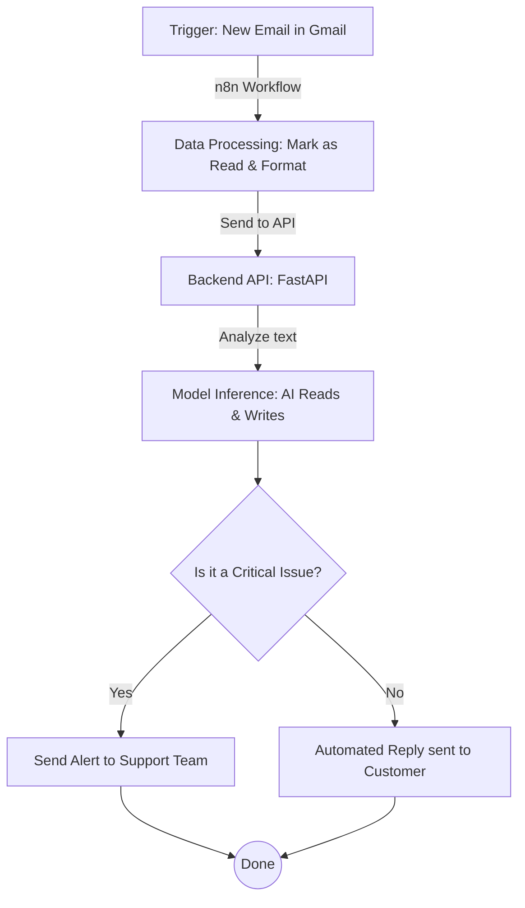

# Project Overview: Email Automation System

Hey there! Let me walk you through this super cool project. It's an end-to-end system that automatically reads your incoming emails, figures out what they are about, and sends a smart, automatic reply. It even uses AI to learn from past examples!

## Architecture Diagram

Here is a simple drawing showing how an email travels from your inbox to getting an automated reply.

## Tech Stack

Here are the tools and languages we used to build this:

*   **Programming Languages:** Python and Bash (for setup scripts).
*   **Frameworks:**
    *   **FastAPI:** This makes our backend web server. It's like the brain's communication hub.
    *   **n8n:** A visual automation tool that acts as the glue, connecting our Gmail to our brain.
*   **Libraries and Machine Learning (ML):**
    *   **Ollama:** Used to run our AI models locally on our computer.
    *   **PyTorch (`torch`) & Hugging Face (`transformers`):** The heavy lifters for building and training our AI.
    *   **PEFT:** Helps us train the AI efficiently without needing a massive supercomputer.
    *   **ChromaDB:** A special database to store our company documents so the AI can search them (this is called RAG).
    *   **pdfplumber:** Helps the AI read PDF documents from our knowledge base.

## The Training Pipeline

To make the AI smarter, we have to teach it using examples. Here is how we do it:

*   **How it's trained:** We use a clever method called "LoRA" which lets us teach the AI new tricks using just a regular computer processor (CPU), instead of needing expensive graphics cards. We use a small base AI model called "TinyLlama".
*   **Training Scripts:** The magic happens in `finetune_cpu.py` (if you are on a regular computer) or `finetune_colab.ipynb` (if you want to use Google's free cloud computers). `prepare_dataset.py` helps clean up the data first.
*   **Dataset:** We feed the AI examples in a special text format called JSONL. It lives in the `data/training/combined_train.jsonl` file.
*   **Model Storage:** After training, the smart AI brain is saved in the `data/finetuned/` folder. We then use a script (`convert_to_ollama.py`) to convert it into a format that Ollama can run easily.

## Automation Flow

You might be wondering, "How does it actually run automatically?" The secret sauce is **n8n**. 

1.  **Polling:** We have a workflow in n8n (saved as `email_flow_clean.json`) that checks Gmail every single minute for new unread emails.
2.  **Processing:** When a new email arrives, n8n grabs it, marks it as "read," and sends the email's text to our FastAPI backend.
3.  **Sending:** The backend AI decides what the reply should be. It tells n8n, and n8n uses Gmail again to send the final reply to the customer. If the AI thinks the email is super urgent (like a server crash), n8n sends a warning email directly to your support team instead.

## Environment Setup

Want to run this yourself? It's pretty straightforward!

1.  **Run the Setup Script:** Just run `./setup.sh` in your terminal. This installs Ollama, downloads the AI models (`llama3.2:3b` and `nomic-embed-text`), and sets up the Python environment.
2.  **Configuration:** Make a copy of the `.env.example` file and name it `.env`. This file holds your custom settings, like the `ALERT_EMAIL` (where urgent messages go).
3.  **Start the Backend:** Open your terminal and run the FastAPI server (`cd backend && source venv/bin/activate && uvicorn main:app --reload --port 8000`) so it can listen for n8n.
4.  **Add Knowledge:** Run a quick command (`curl -X POST http://localhost:8000/ingest`) to let the AI read all your company documents.
5.  **Start n8n:** Open n8n, import the `email_flow_clean.json` file, connect your Gmail account, and turn the workflow on. You are now live!

## Component Breakdown

Here is a quick tour of the folders and files so you don't get lost:

*   **`backend/`**: This is the brain's home. It has the FastAPI server (`main.py`) and the code that talks to the AI (`generator.py`).
*   **`data/`**: The storage room. It holds your company documents (`knowledge_base/`), the database of searched text (`chroma_db/`), and the AI models we trained (`finetuned/`).
*   **`finetune/`**: The school gym. This is where we run scripts to train and exercise our AI model to make it better at answering emails.
*   **`llama.cpp/`**: Tools used behind the scenes to convert our trained models into a format Ollama can understand.
*   **`n8n/`**: The robot messenger. It holds the blueprint (`email_flow_clean.json`) that tells n8n how to check emails and send replies.
*   **`setup.sh`**: Your helpful setup assistant. It's a script that automatically installs everything you need to get started.
