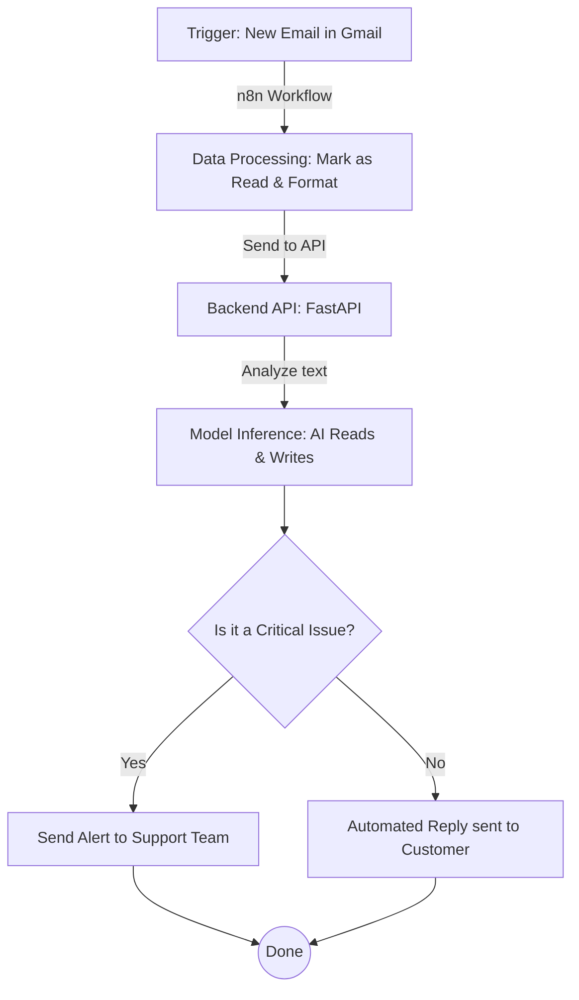

# Email Automation System 🚀

Welcome to the Email Automation System! This project is an end-to-end intelligent automation pipeline that automatically reads incoming emails, categorizes them, determines their severity, and sends an AI-generated smart reply. It also uses RAG (Retrieval-Augmented Generation) to answer questions based on company knowledge, and can escalate critical issues to a support team.

This project was built to save time and ensure customers get immediate, accurate, and helpful responses without manual intervention.

---

## 🏗 Architecture Overview

The system uses a combination of modern tools to achieve seamless automation:



### Tech Stack
*   **Backend:** Python, FastAPI
*   **Automation:** n8n
*   **AI Models:** Ollama (running locally), Hugging Face (`transformers`), PyTorch
*   **Fine-tuning:** PEFT (LoRA) for efficient CPU/GPU training
*   **Knowledge Base (RAG):** ChromaDB, pdfplumber

---

## 📁 Project Structure

Here is a breakdown of the repository to help you navigate:

*   **`backend/`**: The core API.
    *   `main.py`: The FastAPI server that receives emails from n8n.
    *   `generator.py`: Connects to Ollama to process the email, decide severity, and write a reply.
    *   `rag/`: Logic for searching the company documents.
*   **`data/`**: The storage room.
    *   `knowledge_base/`: Drop your company PDFs/documents here.
    *   `chroma_db/`: Vector database used by RAG.
    *   `finetuned/`: Where your fine-tuned models are saved.
    *   `training/`: Contains `.jsonl` files for training the model.
*   **`finetune/`**: Scripts for training the AI to learn your company's tone and rules. Includes both CPU scripts and Google Colab notebooks.
*   **`llama.cpp/`**: Tools used behind the scenes to convert trained models into GGUF format for Ollama.
*   **`n8n/`**: Contains `email_flow_clean.json`, the blueprint for the automation workflow that checks emails and triggers the backend.
*   **`setup.sh`**: Helper script to install dependencies, Ollama, and base models.

---

## 🚀 Getting Started

Follow these steps to get the project running locally.

### 1. Initial Setup
Run the setup script to install Ollama, download necessary AI models (`llama3.2:3b` and `nomic-embed-text`), and set up the Python virtual environment.
```bash
chmod +x setup.sh
./setup.sh
```

### 2. Configuration
Copy the example environment variables and add your own settings (e.g., the `ALERT_EMAIL` for critical escalations).
```bash
cp backend/.env.example backend/.env
```
*Note: Make sure to fill in the required credentials inside `.env`.*

### 3. Start the Backend API
Activate the virtual environment and start the FastAPI server. It will listen for incoming requests from n8n.
```bash
cd backend
source venv/bin/activate
uvicorn main:app --reload --port 8000
```

### 4. Load Knowledge Base (RAG)
Put your company documents inside `data/knowledge_base/`. Then, tell the backend to read and index them into ChromaDB:
```bash
curl -X POST http://localhost:8000/ingest
```

### 5. Start n8n Automation
1. Open your n8n instance.
2. Import the `n8n/email_flow_clean.json` workflow.
3. Connect your Gmail account credentials in n8n.
4. Activate the workflow! It will now poll Gmail every minute and send unread emails to your backend.

---

## 🧠 How the AI Works

### The Processing Pipeline
1. **Reception:** n8n sends the email payload to `http://localhost:8000/process-email`.
2. **Analysis:** The AI (running via Ollama) evaluates the email and returns a JSON structure containing:
   *   `Category` (e.g., Bug, Sales, Question)
   *   `Severity` (Normal or Critical)
   *   `Confidence` (1-5)
   *   `Response` (The drafted reply)
3. **RAG Intervention:** If the AI is unsure or needs specific facts, it searches `chroma_db` for relevant knowledge and reads it before answering.
4. **Action:**
   *   If `Severity` == "Critical", an alert is sent to the human support team.
   *   Otherwise, the AI-generated reply is sent back to the customer via n8n.

### Fine-Tuning the Model
To make the AI sound more like your company and follow specific rules, you can train it further:
1. Prepare your training data in `data/training/combined_train.jsonl`.
2. Run the fine-tuning script inside the `finetune/` directory (e.g., `finetune_7b.py`). We use LoRA to make this process lightweight.
3. After training, convert the model to Ollama format using `convert_to_ollama.py`.

---

## 🛠 Maintenance & Troubleshooting
*   **Model not loading?** Ensure Ollama is running in the background (`ollama serve`).
*   **Bad JSON Responses?** The system has built-in fallback mechanisms to fix broken JSON from the AI, but if it fails repeatedly, consider checking the prompt in `backend/generator.py` or trying a larger/different model.
*   **Missing Knowledge?** Re-run the `/ingest` endpoint if you've added new PDFs to the `knowledge_base` folder.

Good luck, and enjoy your automated inbox!
